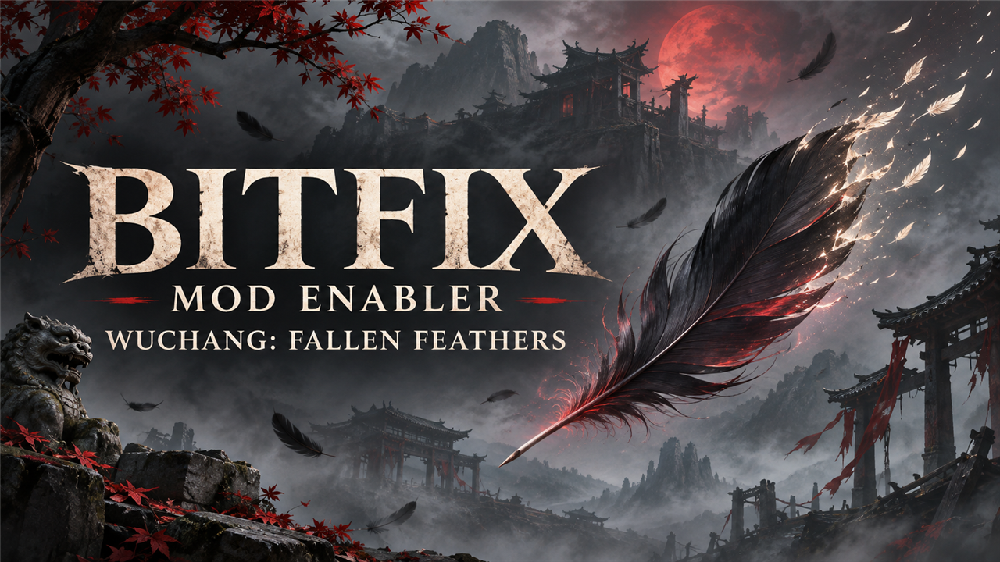

# bitfix

[trumank's bitfix](https://github.com/trumank/bitfix), a Lua-scriptable runtime patcher, with ready packages for
games. For Wuchang: Fallen Feathers it is the Mod Enabler: it turns off the game's pak signature check, so the game
loads mod paks.

## What it does

bitfix is a small DLL by trumank. The game loads it by itself when it has the name of a system DLL that the game
uses, such as `d3d9.dll` or `dsound.dll`. When the game starts, bitfix reads the Lua patches in the folder `bitfix\`
next to it, finds each patch's code in the game by a byte pattern, and changes it in memory. No game file is changed.

This listing republishes bitfix with one ready package per game:

| Game | Zip | What the package does |
|---|---|---|
| Wuchang: Fallen Feathers | `wuchang_bitfix_v0.1.0-80af6c23.zip` | The Mod Enabler: `bitfix\sig.lua` turns off the pak signature check, so the game loads mod paks from `Project_Plague\Content\Paks\~mods\` |

The DLL is the build of bitfix's commit
[`80af6c23`](https://github.com/trumank/bitfix/commit/80af6c231cb9bb1d441f02b3c66da3dbd4af115e) (2024-12-11), the
same file the author uses with the game. Since that commit, bitfix changed only the examples in its README.

## Screenshots

## How to install

1. Close the game.
2. Download the zip for your game (table above) from the latest release on GitHub.
3. Wuchang: Fallen Feathers: unpack it into the game's main folder, the one that holds the folder `Project_Plague\`.
   The files land in `Project_Plague\Binaries\Win64\`, next to `Project_Plague-Win64-Shipping.exe`:
   `d3d9.dll`, `dsound.dll` (the same bitfix DLL under two names), the folder `bitfix\` with `sig.lua`, and
   `bitfix-LICENSE.txt`.
4. Put your mod paks into `Project_Plague\Content\Paks\~mods\` (make the folder if it is not there).
5. Start the game.

To remove it: close the game and delete `d3d9.dll`, `dsound.dll`, the folder `bitfix\` and `bitfix-LICENSE.txt`
from `Project_Plague\Binaries\Win64\`.

## How to use

Nothing to do: with the package in place, the game loads the mod paks in `~mods`.

## Compatibility

- Wuchang: Fallen Feathers (Unreal Engine 5.1): the package works in the author's game.
- Only one file can have each name in `Project_Plague\Binaries\Win64\`. Another tool that also uses the name
  `d3d9.dll` or `dsound.dll` there (for example another DLL loader or an upscaler) clashes with this package: rename
  that tool's file if it allows another name.
- UE4SS ([our UE4SS package for the game](https://github.com/KintaroModding/ue4ss)) uses the name `dwmapi.dll` and
  works beside it.

## Known issues

- `sig.lua` finds the signature check by a byte pattern. A game update that changes that code would need a new
  pattern; the game has not changed it so far.

## How to build

The release ships the tested DLL as it is, not a new build. bitfix builds with Rust (`cargo build --release`; the
upstream workflow uses the nightly toolchain and the target `x86_64-pc-windows-gnu`), see
[bitfix](https://github.com/trumank/bitfix). `FORK.md` lists exactly what this repository and its release files add.

## Credits

bitfix is made by [trumank](https://github.com/trumank) (Truman Kilen), MIT license: see `LICENSE`, also shipped as
`bitfix-LICENSE.txt` in each package. The game packages and the Wuchang: Fallen Feathers patch `sig.lua`: Kintaro,
MIT license, as bitfix. This listing is unofficial: trumank did not make it and does not support it. Report problems
with bitfix itself to the [bitfix issues](https://github.com/trumank/bitfix/issues).
